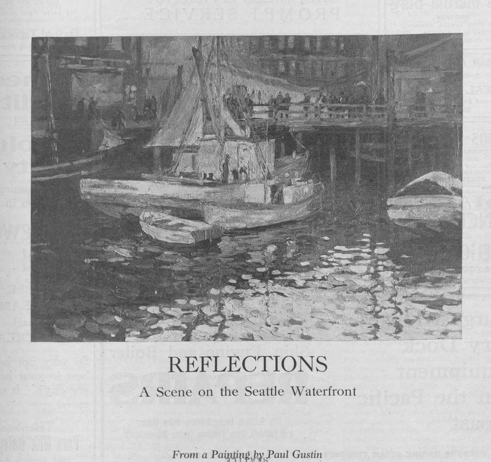

Welcome! I am a PhD student in economics at the University of Washington specializing in urban and development economics. I am interested in housing’s political economy, in particular the issue of incumbency, and its role in improving essential child health indicators. In different circumstances incumbents range from relatively well-connected homeowners in Houston to relatively disenfranchised residents of a [*jhuggi jhopri*](https://www.britannica.com/place/What-are-jhuggi-jhopri-settlements-and-why-have-they-challenged-Delhis-planners) in Delhi. My research studies how housing can get built when there are many competing interests for the land and the relationship between housing and child health in circumstances where quality shelter is scarce. 

<figure class="homepage-art" style="display: block; width: 100%;">
  
  <figcaption>Public domain via <a href="https://picryl.com/">Picryl</a></figcaption>
</figure>
